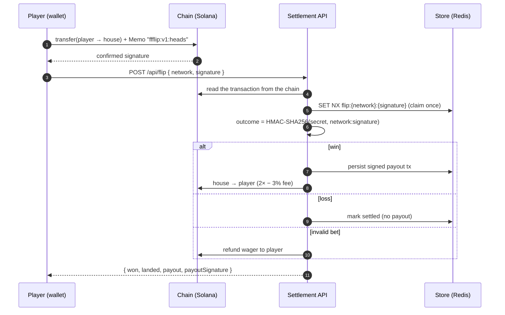

<div align="center">

# ◐ FFFLIP SOL

### TWO SIDES. ONE FLIP.

**A minimalist Solana coin-flip game wrapped in a live, animated ASCII / dither rendering of two reaching hands.**

Choose your side · place your bet · double your wager.

<br/>


</div>

---

## ✦ What is this?

FFFLIP SOL is a coin-flip betting app for Solana. The whole page is the artwork: a photograph of two hands reaching toward each other is re-rendered **in real time** as an animated dither / ASCII field on an HTML canvas, and the coin spins in the gap between the fingertips.

Everything else (the glass bet panel, cut-corner buttons, dithered hover sweeps) is built in the same visual language, so the interface feels like part of the picture instead of sitting on top of it.

> **Win** → you receive **2× your wager minus a 3% platform fee**.
> **Lose** → the wager goes to the house.

## ✦ Features

| | |
|---|---|
| 🎞️ **Live ASCII engine** | From-scratch Canvas2D renderer with **25 render modes**, tone/colour pipeline, 3 blur types, 9 post-effects and 5 animation styles. Responsive, DPR-aware, pauses when the tab is hidden, honours `prefers-reduced-motion`. |
| 🪙 **3D coin** | CSS-3D coin that idles, tosses while the transaction settles, and lands on the real result. |
| 🌐 **Devnet + Mainnet** | One-click network switch. Mainnet requires an explicit confirmation and is **disabled server-side** until you enable it. |
| 👛 **Real wallets** | Phantom and Solflare via `@solana/wallet-adapter`. Real on-chain balance, live-updated. |
| 🔒 **Replay-safe settlement** | Server verifies the bet **from the chain**, claims each signature exactly once, and persists the signed payout *before* broadcasting. |
| 🧾 **Transparent maths** | Integer-lamport arithmetic. The UI shows gross payout, 3% fee and net before you confirm. |
| 🛡️ **Safe by default** | Refunds on invalid bets, bet limits tied to house liquidity, double-submit guard, friendly wallet / RPC error messages. |
| 📱 **Responsive** | Hands stay recognisable from 320 px phones to wide desktops, no horizontal overflow. |

## ✦ How a flip works



**Why it can't be gamed from the browser**

- The server never trusts the client: amount, side and sender are read **from the confirmed transaction**.
- The outcome is a keyed hash of the transaction signature, so it can't be known before the bet exists and can't be influenced by the client. There is no `Math.random()` in the real path.
- Each signature is claimed atomically (`SET NX`), so replays and parallel requests settle **once**.
- The signed payout is stored **before** it is sent. Retries re-broadcast the same transaction, so a crash can never pay twice.

## ✦ Tech stack

| Layer | Tools |
|---|---|
| **Front end** | React 18 · TypeScript · Vite · hand-written CSS (no UI kit) |
| **Art engine** | Canvas2D · ResizeObserver · requestAnimationFrame · Bayer-matrix dithering |
| **Wallets** | `@solana/wallet-adapter` (Phantom, Solflare) · `@solana/web3.js` |
| **Backend** | Vercel Functions (Web-standard `Request`/`Response`) · `bs58` |
| **State** | Upstash / Vercel KV (Redis REST) for replay protection |
| **Tooling** | pnpm · tsx · `node:test` · concurrently |

## ✦ Quick start

```bash
# 1. install
pnpm install

# 2. configure
cp .env.example .env

# 3. generate secrets and paste into .env
node -e "console.log(require('crypto').randomBytes(32).toString('hex'))"   # → FLIP_SECRET
node -e "const k=require('@solana/web3.js').Keypair.generate();console.log('HOUSE_SECRET_KEY='+require('bs58').default.encode(k.secretKey));console.log('address:',k.publicKey.toBase58())"

# 4. fund the house wallet with devnet SOL (so it can pay winners)
#    https://faucet.solana.com  (or: solana airdrop 2 <address> -u devnet)

# 5. add your artwork
cp your-photo.png public/hands.png

# 6. run web (:5173) + API (:8787)
pnpm dev:all
```

Open <http://localhost:5173>, set your wallet to **Devnet**, connect, pick a side, flip.

### Scripts

| Command | What it does |
|---|---|
| `pnpm dev:all` | Vite dev server + local settlement API |
| `pnpm dev` / `pnpm dev:api` | Run either one alone |
| `pnpm build` | Typecheck + production build |
| `pnpm preview` | Serve the production build |
| `pnpm test` | Run the test suite (settlement, replay, refunds, payouts, fee maths) |
| `pnpm typecheck` | `tsc --noEmit` |

> 🎨 **Preview the UI without keys or funds:** `VITE_DEMO_MODE=true pnpm dev`. This is a clearly-labelled mock that moves no SOL. **Never enable it in production.**

## ✦ Environment variables

| Variable | Scope | Purpose |
|---|---|---|
| `HOUSE_SECRET_KEY` | server | House wallet (base58 or JSON byte array). Receives bets, pays winners. **Fund it.** |
| `FLIP_SECRET` | server | ≥ 32 bytes hex. Key for the outcome HMAC. Only its hash is exposed. |
| `MAINNET_ENABLED` | server | `true` to allow mainnet bets. Default `false`. |
| `RPC_DEVNET` / `RPC_MAINNET` | server | RPC endpoints (use a paid RPC for mainnet). |
| `MIN_BET_SOL_*` / `MAX_BET_SOL_*` | server | Bet limits per network. Max is also capped by house liquidity. |
| `UPSTASH_REDIS_REST_URL` / `_TOKEN` | server | Replay-protection store. **Required in production.** |
| `VITE_RPC_DEVNET` / `VITE_RPC_MAINNET` | browser | RPC used by the wallet connection. |
| `VITE_API_BASE` | browser | Only if the API lives on another origin. |
| `VITE_DEMO_MODE` | browser | UI-only mock. Keep `false`. |

## ✦ Deploy to Vercel

1. Push this repo to GitHub and **import it in Vercel**. `vercel.json` and the `packageManager` field handle the rest (pnpm, Vite, `/api` functions).
2. Add a **Vercel KV / Upstash Redis** store. Without it the API refuses every bet, because serverless has no shared memory.
3. Set the env vars above. Start with devnet only.
4. Put your artwork at `public/hands.png`.
5. For mainnet: fund the mainnet house wallet, set `RPC_MAINNET`, `VITE_RPC_MAINNET`, then `MAINNET_ENABLED=true`.

## ✦ Project structure

```
ffflip-sol/
├─ api/                 Vercel functions  (config.ts, flip.ts)
├─ server/              settlement core, handlers, store, tests, local dev server
├─ shared/protocol.ts   wire format shared by browser + server
├─ src/
│  ├─ ascii/            engine.ts · shapes.ts (25 modes) · types.ts · source.ts
│  ├─ components/       AsciiBackground · Coin · BetPanel · Header · Modal
│  ├─ game/             fee maths, browser settlement client
│  ├─ wallet/           providers, network switch, balance hook
│  ├─ App.tsx · main.tsx · styles.css
├─ public/              hands.png (your artwork), favicon
└─ vercel.json · .env.example
```

## ✦ The ASCII engine

`src/ascii/` is a standalone, reusable renderer:

```ts
const engine = new AsciiEngine(canvas, { renderMode: "dither", cellSize: 9 });
engine.setSource(image, image.naturalWidth, image.naturalHeight);
engine.resize(width, height);
engine.start();      // requestAnimationFrame loop (pauses when hidden)
engine.destroy();    // removes observers and listeners
```

Pipeline: background layer → grid sampling → colour adjustments (brightness → contrast → saturation → grayscale → tint) → blur (tilt / lens / progressive / directional) → shapes → post-effects → lighting → reveal mask → animation (`wave`, `pulse`, `shimmer`, `ripple`, `flicker`).

## ✦ Security & honesty notes

This is a **house-operated** game with a trusted settlement server, **not** an on-chain program.

- The house key is a **hot wallet** on the server. Treat it accordingly.
- `FLIP_SECRET` is committed by hash and shown in the UI, but it is **not revealed on-chain**, so players can't independently verify past outcomes yet.
- Bets are capped to a fraction of house liquidity, but the house can still lose money.
- Gambling may be illegal where you live or where your users live. **You** are responsible for compliance.

**Recommended before real money:** an independent security review, rate limiting, a dedicated paid RPC, and ideally moving settlement to an audited on-chain program with verifiable randomness.

## ✦ Roadmap

- [ ] On-chain program + VRF (Switchboard / ORAO) for fully verifiable outcomes
- [ ] Commit-reveal: publish `FLIP_SECRET` per epoch so past flips can be verified
- [ ] Bet history and leaderboard
- [ ] Sound design and haptics
- [ ] More tokens (USDC)

## ✦ Disclaimer

Educational / experimental software, provided **as is**, with no warranty. Play only with funds you can afford to lose.

<div align="center">

**◐ FFFLIP SOL** · two sides, one flip

</div>
